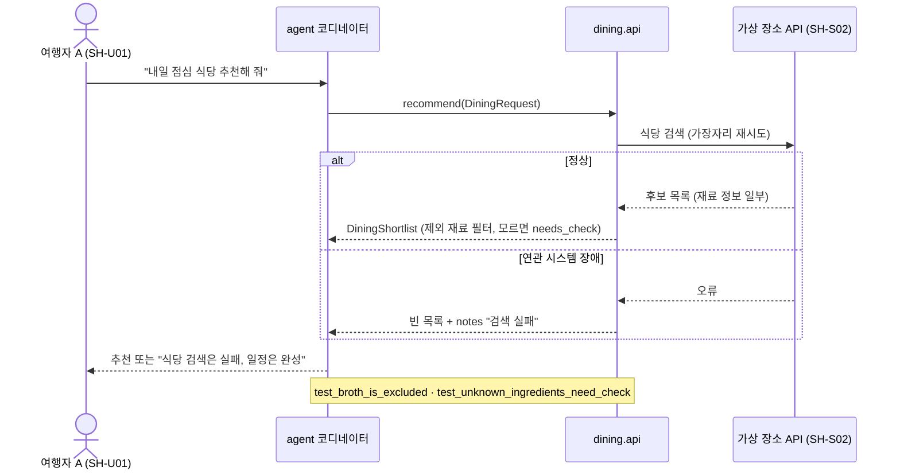

# Spec: 식당 추천

근거: [intent.md](intent.md) · 프로필: lite · 상태: approved

## 요구사항
- 도시, 인원, 식사 조건을 받아 식당 후보를 돌려준다.
- 식사 조건이 제외한 재료(육수 포함)가 확인된 식당은 결과에 없다.
- 재료를 확인할 수 없는 식당은 "확인 필요"로 표시해 결과에 남긴다.
- 장소 API가 실패하면 예외 대신 실패 메시지를 돌려주고, 코디네이터는 나머지 일정으로 답을 완성한다.

## 아키텍처 영향
- 영향 모듈: dining (새 모듈), agent (도구 `suggest_dining` 추가)
- 새 모듈 필요 여부: 예 — places와 바뀌는 이유가 다름. ADR: docs/adr/0001-dining-module.md
- 데이터 소유 모듈: 없음 (외부 API 결과만 사용)
- 계약 변경: 있음 — contract_draft.py (이 폴더) → 계약 게이트에서 app/contracts/travel.py 로 확정

## 이해관계자 영향
| ID | 방향 | 내용 | 통보·승인 필요 |
|---|---|---|---|
| SH-U02 | 이해관계자 → 시스템 | 식사 조건(채식, 육수 포함)이 필터 규칙이 됨 | 예 — 육수 규칙 확인 |
| SH-S02 | 시스템 → 이해관계자 | 식당 검색 호출이 끼니당 1~2회 늘어남 (분당 60회 제한 이내) | 아니오 |
| SH-U01 | 시스템 → 이해관계자 | 추천 응답이 약 1초 늘어남 | 아니오 |

## 계약 질문 목록
- [x] 가격은 1인 기준인가 총액인가? → 1인 기준 가격대(1~4)
- [x] 육수 재료도 제외 대상인가? → 예
- [x] 재료 정보가 없으면? → 결과에 남기되 `needs_check = True`
- [x] 실패는 예외로 알리나? → 아니오. 빈 목록 + `notes`

## 뷰

### 핵심 상호작용 (시퀀스, 실패 경로 포함)
누구의 어떤 질문: 엔지니어·동행자 B — 장소 API가 실패하거나 재료를 모르면 무엇을 보게 되나?

### 컴포넌트 뷰 (변경분)
생략: Lite 프로필, 모듈 지도에 dining 한 줄 추가로 충분

## 표시된 우려
- 장소 API의 재료 정보는 불완전하다. `needs_check` 비율이 높으면 실사용 가치가 떨어진다 → 실증 중 측정
