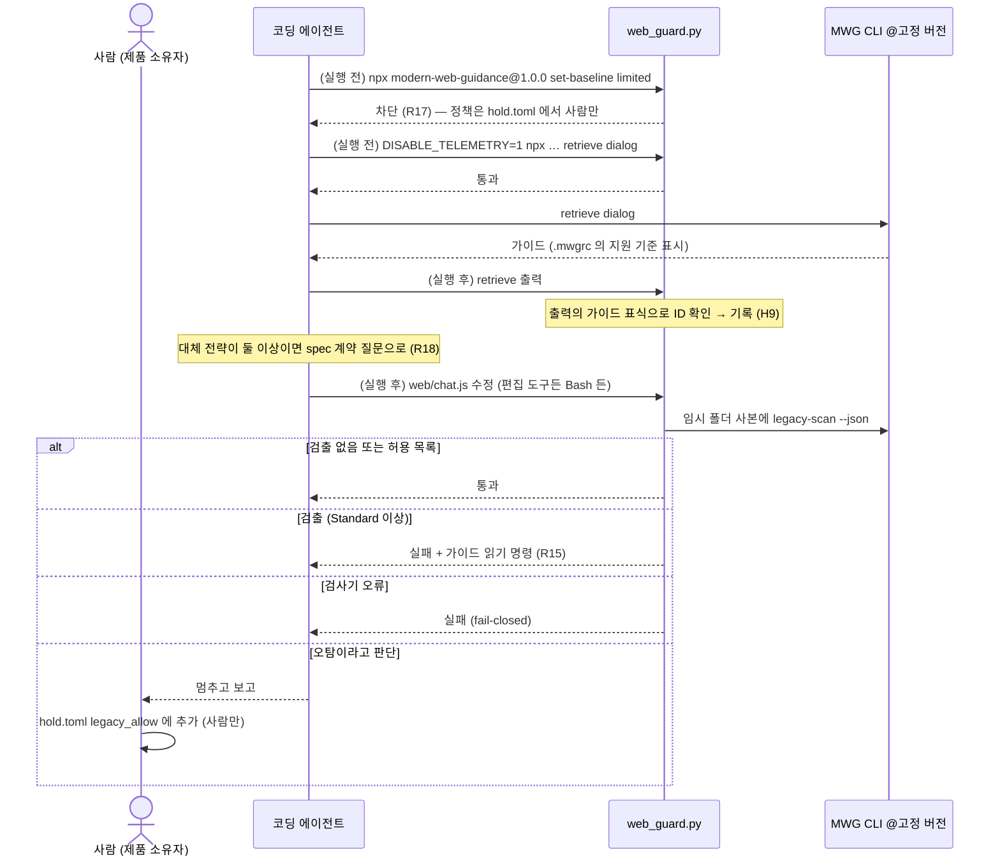

# HOLD 웹 프런트엔드 확장 web-0.1 — Modern Web Guidance 통합

> 확장 **web-0.1** (2026-11-12) · HOLD 코어 v0.1과 함께 씀 · 코어 파일 무수정 · 근거 등급: **가설** (실증 0회)
> 확장 규약: [extensions/README.md](../README.md) · 결정 기록: [ADR 0002](../../method-adr/0002-web-extension-mwg.md) · 적대적 리뷰 원문: [0002 첨부](../../method-adr/0002-adversarial-review.md)

이 문서는 웹 UI가 있는 HOLD 프로젝트에 Google Chrome 팀의 **Modern Web Guidance**(이하 MWG)를 들이는 방법입니다. 한 줄로 줄이면 이렇습니다.

> 무엇이 최신 웹 방식인지는 MWG가 알려 주고, 어느 브라우저를 지원할지와 어느 판의 가이드를 따를지는 사람이 정하며, 그 선은 확장의 훅과 검사가 지킨다.

## 1. 왜 필요한가

### 에이전트는 오래된 방식으로 프런트엔드를 짠다

코딩 에이전트의 학습 데이터에는 오래된 웹 코드가 압도적으로 많습니다. 그래서 브라우저가 이미 기본으로 제공하는 기능이 있어도, 몇 년 전 방식으로 문제를 풉니다.

- 모달을 `<div>`와 JavaScript로 만들고 `body { overflow: hidden }`으로 스크롤을 막는다 (`<dialog>`, Popover API가 있는데도)
- 툴팁 위치를 JavaScript로 계산한다 (CSS Anchor Positioning이 있는데도)
- 채팅 입력창에서 Enter를 누르면 바로 전송한다. 한글처럼 IME로 조합하는 언어에서는 조합 중인 글자가 덜 끝난 채 전송된다
- CDN 스크립트를 무결성 검증(SRI) 없이 불러온다

이런 코드는 **동작은 하므로 테스트를 통과합니다.** 그래서 더 위험합니다. HOLD의 세 부채로 보면 이렇습니다.

| 부채 | 오래된 프런트엔드 코드가 남기는 것 |
| --- | --- |
| 기술부채 | 플랫폼보다 뒤처진 코드, 필요 없는 라이브러리와 폴리필, 접근성·성능 결함 |
| 의도부채 | 이 폴리필이 왜 있는지, 어느 브라우저를 지원하려고 넣었는지 아무도 모름. 지원 브라우저를 누가 정했는지도 모름 |
| 인지부채 | 브라우저 호환성은 사람도 다 기억하지 못함. 에이전트가 고른 대체 코드가 맞는지 판단할 근거가 없음 |

### HOLD v0.1 키트에는 프런트엔드 통제가 없다

v0.1 키트의 통제 장치(pyright, import-linter, Pydantic 계약, 계약·골든 테스트)는 모두 Python 백엔드를 위한 것입니다. 웹 UI를 붙이는 순간 프런트엔드 코드는 **안내도 통제도 없는 영역**이 됩니다. H7("안내는 스킬, 통제는 기계")로 보면 안내층과 통제층이 모두 비어 있습니다.

### 직접 만들지 않고 외부 가이드를 들이는 이유

1. **웹 플랫폼은 빠르게 바뀝니다.** 브라우저별 지원 현황을 1인이 계속 따라가며 가이드를 고칠 수 없습니다.
2. **MWG는 브라우저를 만드는 쪽이 씁니다.** 가이드마다 Baseline 호환성 데이터와 대체 코드 권고가 있고, 에이전트를 대상으로 한 평가 체계가 있습니다.
3. **HOLD의 강점은 내용이 아니라 소유와 통제입니다.** HOLD가 할 일은 가이드를 새로 쓰는 것이 아니라, 외부 가이드를 사람이 소유한 선 안으로 들이는 연결층(바인딩)을 만드는 것입니다.

## 2. Modern Web Guidance 개요

아래 내용은 2026-11-12에 패키지 1.0.0을 직접 받아 확인했습니다.

| 항목 | 내용 |
| --- | --- |
| 무엇 | 코딩 에이전트에 웹 플랫폼 전문 지식, 권장 방식, 브라우저 호환성 데이터를 넣어 주는 에이전트 skill과 CLI |
| 만든 곳 | Google Chrome 팀이 만들고 Chrome·Microsoft Edge·Mozilla Firefox·MDN 팀이 함께 관리. Google I/O 2026에서 발표 |
| 판 | 1.0.0 (2026-11-10). 첫 공개판 0.0.55(2026-04-30) 이후 121번 배포 |
| 내용 | 가이드 208개. 분류: html, css, js, forms, accessibility, performance, security, privacy, pwa, built-in-ai, webmcp, visual-design 등 |
| 구성 | `SKILL.md`(에이전트 지시) + CLI `modern-web-guidance`(공개 하위 명령 `search`, `retrieve`, `list`, `legacy-scan` 외에 설정용 `install`, `update`, `set-baseline`, `set-allow-*`) + 가이드 마크다운 |
| 프로젝트 정책 파일 | `.mwgrc` (JSON: `baseline`, `allowOriginTrials`, `allowVolatileFeatures`). CLI는 현재 폴더부터 위로 올라가며 `.mwgrc`나 `.git`이 처음 나오는 곳에서 멈추고, 끝까지 없으면 홈 폴더(`~/.mwgrc`)를 본다. `retrieve` 출력 머리에 그 기준을 붙인다 |
| 실행 요구 | Node.js 22 이상, `npx` |
| 라이선스 | 코드·skill Apache-2.0, 문서 CC BY 4.0 |
| 저장소 | [GoogleChrome/modern-web-guidance](https://github.com/GoogleChrome/modern-web-guidance) |

### 작동 방식

원본 `SKILL.md`는 에이전트에게 네 단계를 지시합니다. ① 2~5단어 질의로 **search** → ② 찾은 ID의 가이드 본문을 **retrieve**(구현, 접근성, Baseline 현황, 대체 전략) → ③ 구현이 권장 방식과 대체 전략을 따르는지 **verify** → ④ 응답 끝에 `### Modern Web Guidance` 절로 **disclose**. 기존 코드 현대화에는 정적 검사 `legacy-scan`이 따로 있습니다.

### Baseline

| 수준 | 뜻 |
| --- | --- |
| Widely available | 주요 브라우저 모두에서 30개월 이상 지원 (MWG 기본값) |
| Newly available | 주요 브라우저 모두에서 지원한 지 30개월 미만 |
| Limited availability | 일부 브라우저만 지원 |
| `Baseline YYYY` | 그 해까지 Baseline이 된 기능 |

### 제작사가 공개한 평가 (외부 근거)

| 에이전트 + 모델 (2026-11-08) | 과제 / 채점 항목 | 가이드 없음 → 가이드 있음 |
| --- | --- | --- |
| Claude Code (Opus 5.5) | 215 / 1,801 | 57% → 88% (+31%p) |
| Codex CLI (gpt-6.1-sol) | 215 / 1,795 | 54% → 82% (+28%p) |
| Antigravity CLI (gemini-4-argon) | 214 / 1,673 | 58% → 94% (+36%p) |

**제작사의 과제를 제작사의 채점 기준으로 잰 값**이고, 재는 것은 "Chrome 팀 권장 방식을 얼마나 따랐나"입니다. 앱 품질이나 개발 속도가 아닙니다. HOLD는 이 수치를 외부 근거로만 표시하고, 근거 등급은 실증으로만 올립니다.

### 직접 확인한 특성 (1.0.0)

- **가이드는 호출할 때마다 최신판을 받습니다.** 원본 `SKILL.md`는 모든 명령을 `@latest`로 지시합니다.
- **업데이트를 독촉합니다.** CLI는 skill 버전과 자기 버전을 비교해, 5일 넘게 뒤처지면 경고하고, 60일이면 에이전트에게 사용자를 설득하라고 지시합니다("insist that the user upgrade").
- **정책을 에이전트가 바꾸도록 유도하는 경로가 셋입니다.** "Reactive Policy Discovery"(CLAUDE.md·AGENTS.md에 정책을 적자고 제안), 숨은 하위 명령 `set-baseline`(도움말에 없음), 그리고 `.mwgrc` 파일 자체입니다.
- **`legacy-scan`은 그대로는 통제 장치가 아닙니다.** 규칙 35개(가이드의 약 20%)만 검사하고, 검출이 있어도 종료 코드가 0입니다. 인자를 해석하지 못해도 `"error"` 필드가 있는 JSON과 함께 0으로 끝납니다. 폴더를 검사할 때는 `.gitignore`를 따릅니다.
- **텔레메트리가 있습니다.** 설치 수, 호출한 에이전트 이름, 가이드 ID, 에이전트가 만든 검색어를 Google로 보냅니다. `DISABLE_TELEMETRY=1`이면 보내지 않습니다.
- **retrieve 출력이 길면 파일로 저장합니다.** 출력에 "saved to /tmp/mwg-guide-….md"만 나오고 본문은 그 파일에 있습니다.

## 3. 그대로 들이면 생기는 충돌

| # | MWG의 기본 동작 | 부딪히는 원칙 | 무엇이 문제인가 | 확장의 해법 |
| --- | --- | --- | --- | --- |
| 1 | 정책을 CLAUDE.md에 적자고 제안, `set-baseline`, `.mwgrc` | H1 | "어느 사용자의 브라우저를 지원하나"라는 업무 결정이 사람 확정 없이 바뀐다. 실제 도구 출력을 정하는 `.mwgrc`가 보호 밖에 있다 | 정책 원본은 `hold.toml [web]`. `sync.py`가 `.mwgrc`를 **생성**하고, `.mwgrc`는 위치와 상관없이 보호. 설정 하위 명령은 차단 (R14·R17) |
| 2 | 대체 전략이 여럿이면 에이전트가 고름 | H5 | 업무 결정이다 | spec의 계약 질문으로 (R18) |
| 3 | 매 호출 `@latest` | H10, 동결 | 측정 결과가 어느 판의 것인지 말할 수 없다 | 버전·npm 무결성 값 고정, 올리는 것은 사람의 변경 (R17) |
| 4 | 60일 지나면 사용자를 설득하라고 지시 | H1 | 도구가 에이전트를 통해 사람의 결정을 압박한다 | skill과 CLI를 같은 패키지에서 고정해 독촉 자체를 없앰 (R17) |
| 5 | 응답 끝 공개 절 | H9 | 에이전트의 말이다 | spec에 `mwg:<id>`, 고정 목록과 대조. retrieve의 **실제 출력**에서 확인한 ID만 기록 (R16) |
| 6 | `legacy-scan` 종료 코드 0, 오류도 0, `.gitignore` 따름 | H7 | 그대로는 통제 장치가 아니다. 실패로 만들면 에이전트가 코드를 비튼다 | 임시 폴더에 복사해 검사, 오류는 실패로, 받아들인 검출은 사람이 허용 목록에 (R15) |
| 7 | 텔레메트리 기본 켜짐 | 통제·검증 주체 | 공공 과제에서 검색어가 외부로 나간다 | 접두어 없는 호출은 훅이 차단, 키트 메시지에도 접두어 |
| 8 | 매 호출 네트워크 | — | 폐쇄망에서 쓸 수 없다 | 미리 받은 tarball로 고정, npm 캐시로 실행 |
| 9 | 확장이 코어에 끼어들기 쉬움 | 동결 | "확장"이 코어 개정의 우회로가 된다 | 코어 무수정, 별도 훅 등록, 매니페스트로 기계 검사 ([확장 규약](../README.md)) |

## 4. 원칙별 통합 방식

| 원칙 | 확장에서의 적용 |
| --- | --- |
| H1 사람의 역할 | 지원 기준, 대체 정책, 실험 기능 허용, MWG 버전·무결성 값, 허용 목록은 모두 `hold.toml [web]`(코어 보호)에 있다. 생성물(`.mwgrc`, 고정 skill, 가이드 목록, lock)과 사용 환경 파일, 확장 코드, 훅 로그는 확장 훅이 지킨다. `sync.py`·`install.py`는 사람만 실행한다 |
| H2 모든 산출물에 주인 | 가이드 내용의 주인은 MWG(외부), 어느 판을 쓸지의 주인은 사람. 생성물은 결정적이라 `hold.toml`과 패키지가 같으면 누가 만들어도 같은 바이트다 |
| H3 이해관계자와 관점 | `docs/architecture/usage-environments.md`에 사람 이해관계자마다 **사용 환경**을 적는다. 지원 기준은 여기서 나온다 |
| H4 커밋된 산출물 체인 | spec의 `## 참조 가이드`가 "어떤 외부 기준을 근거로 이렇게 구현했나"의 기록. 버전·정책 변경은 `lock.json` 차이로 커밋에 남는다 |
| H5 계약 우선 | 지원 기준 밖 브라우저에서의 동작은 화면이라는 경계의 계약. 대체 전략 고르기는 계약 질문 |
| H7 안내는 스킬, 통제는 기계 | 안내는 고정 skill의 "HOLD 프로젝트 규칙" 절과 CLAUDE.md, 통제는 `web_guard.py` 훅과 `web_check.py`. 장치가 없는 R18은 "안내만" |
| H8 보이게 만든다 | 새 필수 뷰는 더하지 않는다. 지원 브라우저 매트릭스 뷰는 v0.2 후보 |
| H9 에이전트가 읽는 증거 | 완료의 증거는 검사 출력, 그리고 retrieve 실제 출력에서 확인한 가이드 ID 기록 |
| H10 닫힌 루프 | MWG 버전을 올리는 일은 프로젝트의 변경. 확장 자체는 실증 회고에서 유지·수정·삭제 |

## 5. 구조

확장은 코어 키트가 설치한 파일을 고치지 않습니다. 프로젝트에 다음을 더합니다.

| 위치 | 역할 | 지키는 쪽 |
| --- | --- | --- |
| `.claude/hooks/web_guard.py` | PreToolUse·PostToolUse 훅 (코어 훅과 별도 항목으로 등록, timeout 120초) | 코어 (`.claude/`) + 확장 |
| `.claude/hold-web/common.py` | 설정 검증, 셸 명령 해석기, 보호 경로, 생성물 렌더러, 레거시 검사 | 코어 + 확장 |
| `.claude/hold-web/sync.py` | 고정 설치 (사람만 실행) | 코어 + 확장 |
| `.claude/hold-web/web_check.py` | 설치·고정·사용 환경·참조 가이드 검사, 측정 집계 | 코어 + 확장 |
| `.claude/hold-web/web_scan.py` | 레거시 검사 명령 (pre-commit) | 코어 + 확장 |
| `hold.toml`의 `[web]` | 정책의 원본 | 코어 (`hold.toml`) |
| `.claude/skills/modern-web-guidance/` | 고정 skill + LICENSE (생성물) | 코어 + 확장 |
| `.mwgrc` | MWG 정책 파일 (생성물). 다른 위치의 `.mwgrc`는 금지 | 확장 (위치 무관) |
| `docs/hold/web/guides.json`, `lock.json` | 가이드 ID 목록, 생성물 해시와 정책 (생성물) | 확장 |
| `docs/architecture/usage-environments.md` | 사람 이해관계자의 사용 환경 | 확장 |
| `.hold/logs/` | 훅 로그 (측정 근거) | 확장 |
| `docs/hold/web-measurement.csv` | 웹 확장 측정 시트 | — |
| `CLAUDE.md`, `changes/_template/spec.md` | `hold-web` 표식 사이의 절 | — |

### 설치 절차

```bash
# 0. 코어 키트가 설치된 프로젝트 (새 프로젝트든, 실증 중인 v0.1 프로젝트든 같다)
python kit/scripts/hold_init.py --target ../my-app --profile lite        # 이미 했으면 생략

# 1. 확장 설치 (사람)
python extensions/web/install.py --target ../my-app

# 2. (사람) docs/architecture/usage-environments.md 의 사용 환경을 채우고 hold.toml [web] 의 baseline·fallback_policy 를 정한다

# 3. (사람) MWG 고정 — npm 의 무결성 값을 hold.toml 에 적고, 검증한 패키지로 생성물을 만든다
cd ../my-app
python .claude/hold-web/sync.py --pin 1.0.0

# 4. (사람) .pre-commit-config.yaml 에 extensions/web/kit/templates/pre-commit-snippet.yaml 을 붙인다 (Standard 이상 필수)

# 5. 검사 후 커밋, Claude Code 재시작
python .claude/hold-web/web_check.py
```

실증 중인 프로젝트에서 이 설치는 그 프로젝트의 intent로 남깁니다(확장 규약 6).

### 고정 설치가 보장하는 것

- **무결성.** `hold.toml [web]`의 `mwg_integrity`(npm의 sha512 SRI 값)와 맞는 패키지로만 설치됩니다. 다른 패키지를 주면 멈춥니다.
- **결정성.** 생성물은 패키지와 `[web]` 정책만으로 정해집니다. 그래서 `sync.py`를 누가 실행하든 사람이 허락한 결과만 나옵니다.
- **대조.** `web_check.py`는 `lock.json`의 해시로 생성물을 대조합니다. npm 캐시에 고정 패키지가 있으면 생성물 전체를 다시 만들어 바이트 단위로 대조합니다. lock까지 맞춰 꾸민 생성물도 잡힙니다.
- **정책 동기화.** `[web]` 정책을 바꾸고 `sync.py`를 다시 돌리지 않으면 `web_check.py`가 실패합니다.

생성 skill이 원본에서 바꾸는 것은 네 가지입니다. ① `@latest` → `@<고정 버전>`(원본에서 찾지 못하면 설치 중단), ② MWG 명령 앞에 `DISABLE_TELEMETRY=1`, ③ 머리에 생성 표시(출처·라이선스·변경 고지), ④ 끝에 "HOLD 프로젝트 규칙" 절(R14~R18, 원본보다 우선한다고 명시).

### 훅이 하는 일

**실행 전 (PreToolUse)**
- 편집 도구로 확장 보호 경로를 쓰려 하면 막습니다. `.mwgrc`는 프로젝트 밖(예: `~/.mwgrc`)도 포함합니다.
- Bash 명령을 셸 문법대로 해석합니다(따옴표, `&&`·`|`·`;`, 줄 이음, `$(…)`·백틱, `bash -c`, `env`·`xargs`·`timeout` 같은 감싸는 명령, `npx -c`·`-p`).
  - MWG 호출은 고정 버전, 하위 명령 `search`·`retrieve`·`list`·`legacy-scan`, 텔레메트리 접두어(훅 환경에 `DISABLE_TELEMETRY=1`이 있으면 면제)를 모두 만족해야 통과합니다.
  - 실행 명령에 패키지 이름이 있는데 정상 호출로 해석되지 않으면 막습니다(fail-closed). `grep`·`git`·`echo` 같은 언급은 예외입니다.
  - 확장 보호 경로를 건드리는 명령은 읽기 전용 명령(`cat`, `grep`, `git diff` 등)과 검사 스크립트 실행만 허용합니다.
  - `sync.py`·`install.py` 실행은 막습니다.
- Bash 실행 전 프런트엔드 파일의 스냅샷을 남깁니다.

**실행 후 (PostToolUse)**
- 바뀐 프런트엔드 파일을 레거시 검사합니다. 편집 도구로 고친 파일이든, Bash 실행 전후 스냅샷을 비교해 찾은 파일이든 같습니다. 파일을 임시 폴더에 복사해 검사하므로 `.gitignore`나 파일 이름(예: `-x.js`)의 영향을 받지 않습니다. Jinja 템플릿(`.j2`, `.jinja`, `.njk`)은 HTML로 검사합니다.
- `changes/` 아래 산출물을 고치면 그 변경의 참조 가이드를 검사합니다.
- `retrieve`를 실행했으면, 실제 출력(파일로 저장된 출력 포함)에서 `--- Guide for <id> ---` 표식을 찾아 고정 목록에 있는 ID만 "확인됨"으로 기록합니다.

## 6. 설정: `hold.toml`의 `[web]`

설정의 형이 틀리면(예: `enabled = "false"`) 훅이 판단을 멈추고 Bash·편집을 막으며, `web_check.py`도 실패합니다.

| 키 | 기본값 | 뜻 |
| --- | --- | --- |
| `enabled` | `true` (설치 시) | 끄면 모든 웹 장치가 통과한다 |
| `ext_version` | `"0.1"` | 확장 판. 설치된 코드의 판과 같아야 한다 |
| `since` | 설치 날짜 | 이 날짜(YYYYMMDD) 이후의 변경에만 R16 적용 |
| `mwg_version`, `mwg_integrity` | `"1.0.0"`, `sync.py --pin`이 채움 | 고정 버전과 npm 무결성 값 (R17) |
| `baseline` | `"widely"` | 지원 기준 (R14): `widely`, `newly`, `limited`, 연도 |
| `fallback_policy` | `""` | 지원 기준 밖 브라우저의 대체 동작 정책 |
| `allow_origin_trials`, `allow_volatile_features` | `false` | MWG 실험 기능 허용 (`.mwgrc`로 옮겨짐) |
| `telemetry` | `false` | `false`면 접두어 없는 MWG 호출을 막는다 |
| `legacy_scan` | `"auto"` | `off`, `log`, `block`, `auto`(Lite는 log, Standard 이상은 block) |
| `legacy_allow` | `[]` | `"가이드ID"` 또는 `"가이드ID:경로패턴"` (`*`는 한 폴더 안, `**`는 하위 폴더까지) |
| `frontend_suffixes`, `template_suffixes`, `skip_dirs` | (기본 목록) | 검사 대상과 제외 폴더 |

지원 기준은 기술 선택이 아니라 **누구를 지원하느냐**의 결정입니다. 사용 환경 표에서 가장 오래된 환경을 기준으로 정합니다. 관리형 브라우저만 쓰는 내부 업무 시스템이라면 연도 타겟을 검토할 수 있고, 불특정 시민이 쓰는 서비스라면 `widely`가 안전합니다. 확신이 없으면 `widely`로 두고, 사고 기록이 근거를 줄 때 바꿉니다.

## 7. 단계별 통합

| 단계 | 더하는 것 | 누가 | 검사 |
| --- | --- | --- | --- |
| 0 착수 | 사용 환경 표 → `[web]` 정책 → `sync.py --pin` | 사람 | `web_check.py`: 사용 환경(양식 그대로·해당 없음만·없는 ID 금지), 설치·고정 |
| 1 Plan | 화면을 바꾸는 변경이면 intent의 이해관계자에 그 화면을 쓰는 사람 ID | 발안자 | 코어와 같음 |
| 2 Design | 에이전트가 search·retrieve → spec `## 참조 가이드`에 `mwg:<id>`와 적용점. 대체 전략이 여럿이면 `(웹)` 계약 질문 | 에이전트 초안, 제품 소유자 승인 | 훅·`web_check.py`: 절 하나, `mwg:` 표기, 고정 목록, 자리표시자 금지 (R16) |
| 2.5 계약 게이트 | `(웹)` 질문에 사람이 답한다. 프로젝트 전체 정책이면 `fallback_policy`로 올리고 `sync.py` | 사람 | `web_check.py`: 정책 동기화 |
| 3 Build | 프런트엔드 파일을 바꿀 때마다 레거시 검사. 비고정·설정 변경·텔레메트리 호출은 실행 전에 막힘 | 에이전트 | `web_guard.py` (R15·R17) |
| 4 Test | 지원 기준 밖 브라우저의 동작을 계약 질문의 답대로 고정하는 테스트 | 기준은 사람 소유 | 코어와 같음 |
| 5 Deploy | PR에 참조 가이드, 레거시 검출, 허용 목록 변경 | 엔지니어 | pre-commit `hold-web-check`, `hold-web-legacy-scan` |
| 6 Maintain | 브라우저 관련 사고는 브라우저·버전을 적고, 원인이 지원 기준이면 사용 환경 갱신과 새 intent | 서비스 소유자 | 코어와 같음 |

### Build 단계의 흐름

누구의 어떤 질문: 엔지니어·리뷰어 — 에이전트가 프런트엔드 코드를 고칠 때 어떤 장치가 언제 끼어드나?



## 8. 통제 대응표 (확장 규칙 R14~R18)

코어 대응표(5.5)의 R01~R13에 이어 번호를 붙입니다. **강제 1, 부분 3, 안내만 1**입니다. 초판은 "강제 2, 부분 2"라고 적었지만 적대적 리뷰에서 과장으로 확인되어(리뷰 4절) 다시 매겼습니다.

| R | 규칙 | 원칙 | 안내 | 통제 장치 | 시점 | web-0.1 |
| --- | --- | --- | --- | --- | --- | --- |
| R14 | 지원 기준·대체 정책·실험 기능 허용은 사람이 정하고 `hold.toml`에만 둔다 | H1·H3 | 고정 skill HOLD 절, CLAUDE.md | `.mwgrc` 생성(`sync.py`)·보호(위치 무관)·대조(`web_check.py`), `set-baseline`·`set-allow-*` 차단, 사용 환경 검사 | 실행 시도, 수정 시도, 커밋 | 부분 (에이전트가 CLAUDE.md에 정책 같은 문구를 쓰는 것은 막지 못함) |
| R15 | 프런트엔드 코드는 고정 버전의 레거시 규칙을 통과하거나, 사람이 허용 목록에 올린다 | H7 | MWG skill | `web_guard.py`(편집 도구·Bash 모두), pre-commit `hold-web-legacy-scan` | 수정 직후, 커밋 | 부분 (규칙 35개 ≈ 가이드의 20%. Lite는 기록만) |
| R16 | spec은 참조한 가이드를 `mwg:<id>`로 적는다. 쓰지 않았으면 구체적인 생략 이유 | H4·H9 | 고정 skill HOLD 절, spec 양식 | `web_guard.py`(산출물 수정 직후), `web_check.py`(pre-commit) | 수정 직후, 커밋 | 부분 (프런트엔드가 바뀐 변경에서 "생략"을 거부하지는 못함. 실제로 읽었는지는 측정으로 봄) |
| R17 | MWG는 사람이 고정한 버전·무결성의 패키지로만, 허용된 하위 명령과 텔레메트리 끔으로만 쓴다 | H1·H10 | 고정 skill HOLD 절 | `web_guard.py`(명령 해석, fail-closed), 무결성 검증(`sync.py`), 생성물 재생성 대조(`web_check.py`), 사람 전용 스크립트 차단 | 실행 시도, 설치, 커밋 | 강제 (Bash는 명령 해석 기반. 문자열을 조립·난독화한 실행은 못 잡고, 그 결과물은 커밋 시 대조로 잡음) |
| R18 | 가이드가 대체 전략을 둘 이상 제시하면 에이전트가 고르지 않고 계약 질문으로 남긴다 | H5 | 고정 skill HOLD 절, spec 양식, CLAUDE.md | — | — | 안내만 |

### 키트의 검증

`extensions/web/tests/`의 테스트 90개(매개변수 포함)가 확장 장치를 검증합니다. 리뷰의 재현 공격 하나하나를 `ADV-xx` 이름의 회귀 테스트로 고정했습니다. 코어 테스트 37개는 그대로 통과하고, 코어 파일은 매니페스트와 같습니다. 네트워크 없이 돌도록 가짜 `npx`·`npm`과 가짜 MWG 패키지를 씁니다. 실제 MWG 1.0.0과의 통합은 ADR 0002의 "통합 확인"에 기록했습니다.

```bash
cd extensions/web/tests && python -m pytest -q
```

## 9. 프로필별 요구 수준

| 항목 | Lite | Standard | Regulated |
| --- | --- | --- | --- |
| 고정 설치, 사용 환경, 참조 가이드 | 필수 | 필수 | 필수 |
| 레거시 검사 | 기록만 | 차단 | 차단. 검사를 못 하면(npx 없음 등) 그것도 차단 |
| pre-commit 웹 검사 | 권장 (없으면 경고) | 필수 | 필수 |
| 텔레메트리 | 끔 | 끔 | 끔. 관리 설정으로 `play.googleapis.com` 송신도 막는 것을 권장 |
| MWG 플러그인 | 프로젝트에서 끔 | 끔 | 허용 목록에서 제외 |
| 하네스 평가 (6장) | — | 웹 과제 포함 권장 | 웹 과제 포함 필수 |
| 접근성 인증 | — | — | MWG 접근성 가이드는 WCAG 일반 수준. KWCAG 인증은 별도 점검 |

## 10. 측정

웹 확장의 측정은 코어 측정 시트와 섞지 않고 `docs/hold/web-measurement.csv`에 적습니다(확장 규약 6). 원자료는 `python .claude/hold-web/web_check.py --metrics`가 훅 로그에서 집계합니다.

| 열 | 뜻 |
| --- | --- |
| `change_id`, `web_ext`, `mwg_version` | 어느 변경, 어느 판의 결과인가 |
| `guides_referenced` | spec `## 참조 가이드`의 `mwg:` ID 수 |
| `guides_retrieved_confirmed` | retrieve 실제 출력에서 확인된 ID 수 |
| `legacy_findings`, `legacy_allowed` | 레거시 검출(허용 목록 제외)과 허용 목록으로 뺀 것 |
| `scan_skips`, `guard_blocks` | 검사를 못 한 횟수, 훅이 막은 횟수 |

| 지표 | 보는 것 |
| --- | --- |
| 참조 일치율 = spec 참조 ID 중 확인된 retrieve ID의 비율 | 에이전트의 말과 기록이 일치하는가 (H9) |
| 레거시 재발 | 같은 가이드가 두 번 이상 검출되면 CLAUDE.md "알려진 함정"에 한 줄 |
| 허용 목록 증가 | 오탐이 많은가, 정책을 우회하려는 압력이 있는가 |
| 검사 스킵·차단 횟수 | 장치가 실제로 돌고 있는가, 에이전트가 어디서 자꾸 막히는가 |

**레거시 검출 0은 좋은 것이 아닐 수 있습니다.** 검사 범위가 가이드의 20%뿐이기 때문입니다. 참조 일치율과 함께 봅니다.

## 11. 알려진 한계 (web-0.1)

- **검사 범위.** 레거시 검사는 가이드의 약 20%만 다룹니다. 나머지는 안내(skill)에 머뭅니다.
- **R14의 빈틈.** 정책 원본과 `.mwgrc`는 지켜지지만, 에이전트가 CLAUDE.md에 정책 같은 문구를 쓰는 것은 막지 못합니다.
- **R16의 빈틈.** 프런트엔드 파일이 바뀐 변경에서 "생략: 이유"를 쓰는 것을 막지 못합니다(변경 폴더와 코드 변경의 연결이 v0.1에 없음). 측정의 참조 일치율로 봅니다.
- **Bash 해석의 한계.** 셸 문법은 해석하지만, 문자열을 조립하거나 인코딩해 실행하는 코드(예: Python `exec`로 만든 명령)는 실행 전에 잡지 못합니다. 그 결과로 생성물이 바뀌면 커밋 때 `web_check.py`가 잡고, 프런트엔드 파일이 바뀌면 실행 후 스냅샷 비교가 잡습니다.
- **사람 전용 스크립트 거부.** `sync.py`·`install.py`는 `CLAUDECODE` 환경 변수가 있으면(빈 값 포함) 실행을 거부하고, 훅도 실행 명령을 막습니다. 둘 다 우회되더라도 무결성 검증 때문에 허락되지 않은 생성물은 만들 수 없습니다.
- **로그의 신뢰.** 훅 로그는 확장이 보호하지만 해시 체인은 없습니다. 측정 근거로는 충분하되, 감리 증거로 쓰려면 Regulated에서 로그 보존 방식을 따로 정해야 합니다.
- **코어의 빈틈은 그대로.** 코어의 `scripts/check_views.py`가 보호 경로가 아닌 것은 코어 v0.1의 문제라 이 확장에서 고치지 않았습니다(v0.2 후보).
- **원본 형식 의존.** `sync.py`는 원본 `SKILL.md`의 `@latest` 명령 형식과 패키지 구조에 기대어 변환합니다. 바뀌면 설치를 멈춥니다.
- **비용.** 웹 확장을 켜면 Bash 실행마다 훅이 두 번(전·후) 돌고, 프런트엔드 파일 스냅샷을 만듭니다.
- **텔레메트리 범위.** 사람이 터미널에서 MWG를 직접 실행할 때는 셸 설정(`export DISABLE_TELEMETRY=1`)이 필요합니다.
- **접근성 인증과 프레임워크.** KWCAG 항목은 다루지 않습니다. React·Vue 등에는 가이드의 적응 지침만 있습니다.
- **근거 등급.** 실증 0회. 모든 규칙의 근거 등급은 가설입니다.

## 12. 개정

- 확장의 판 번호는 `web-0.N`입니다. 발행 전 적대적 리뷰가 필수입니다(확장 규약 5).
- **MWG 버전을 올리는 것은 방법론 개정이 아니라 프로젝트의 변경입니다.** `changes/<YYYYMMDD-mwg-x.y.z>/intent.md`에 이유를 적고, 사람이 `sync.py --pin x.y.z`를 실행합니다. `guides.json`과 `lock.json`의 차이가 같은 커밋에 남습니다.
- v0.2 회고에서 판정할 것: 확장 규약을 8장에 넣을지, 확장을 코어로 올릴지, R14~R18 각각의 유지·수정·삭제, 지원 브라우저 매트릭스 뷰.
