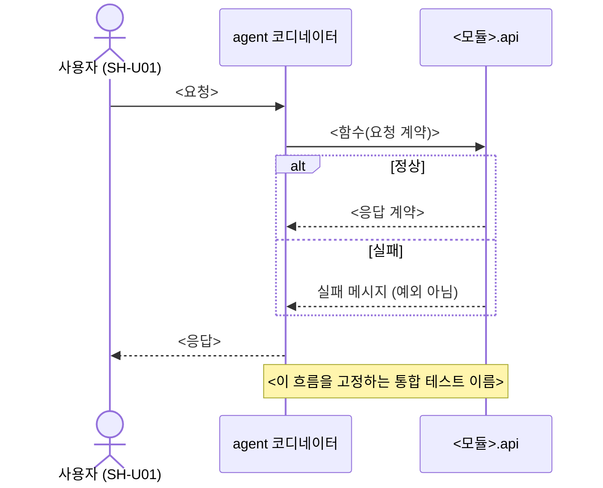

# Spec: <변경 이름>

근거: [intent.md](intent.md) · 프로필: <lite> · 상태: draft

## 요구사항
- <intent의 원하는 결과를 검증 가능한 문장으로>

## 아키텍처 영향
- 영향 모듈: <확정>
- 새 모듈 필요 여부: <예/아니오 — 예라면 ADR 초안 경로>
- 데이터 소유 모듈: <이 변경이 읽고 쓰는 데이터의 주인>
- 계약 변경: <없음 / contract_draft.py (이 폴더)>

## 이해관계자 영향
| ID | 방향 | 내용 | 통보·승인 필요 |
|---|---|---|---|
| SH-U01 | 시스템 → 이해관계자 | <이 변경이 그에게 닿는 방식> | <아니오> |

## 계약 질문 목록
<!-- 에이전트는 답하지 않고 질문만 남깁니다. 사람이 답하면 계약 게이트(Stage 2.5)로 갑니다. -->
- [ ] 단위와 통화는?
- [ ] 값이 없을 때(None)는 무엇을 뜻하나? (모름 / 해당 없음 / 0)
- [ ] 허용 범위는? (최솟값, 최댓값, 글자 수)
- [ ] 실패는 예외로 알리나, 빈 결과로 알리나?
- [ ] 이 값은 누가 계산하나? (LLM / 코드)
<!-- 웹 확장: 프런트엔드 변경이 있고, 가이드가 대체 전략을 둘 이상 제시하면 아래처럼 묻습니다 (9장). -->
- [ ] (웹) 지원 기준(hold.toml [web].baseline) 밖 브라우저에서는 어떻게 동작하나? (기능 빼기 / 단순 대체 / 폴리필)

## 참조 가이드
<!-- 웹 확장(hold.toml [web].enabled = true)에서 필수입니다 (R16).
     Modern Web Guidance 에서 search·retrieve 한 가이드 ID 를 백틱으로 적고, 이 변경에 적용할 점을 한 줄로 씁니다.
     예:  - `light-dismiss-a-dialog` — 바깥 클릭으로 닫기는 closedby="any", 미지원 브라우저는 계약 질문에서 정한 대로
     백틱은 가이드 ID 에만 씁니다. 프런트엔드 변경이 없거나 웹 확장을 쓰지 않으면 "생략: 이유" 한 줄. -->
생략: <이유 — 예: 프런트엔드 변경 없음>

## 뷰
<!-- 각 다이어그램 첫 줄에 "누구의 어떤 질문에 답하는가"를 적습니다. -->

### 핵심 상호작용 (시퀀스, 실패 경로 포함)
누구의 어떤 질문: <예: 엔지니어 — 연계 시스템이 실패하면 사용자는 무엇을 보나?>

### 컴포넌트 뷰 (변경분)
<!-- Lite에서는 선택, Standard 이상은 필수. 바뀌지 않으면 "생략: 이유". -->
생략: <이유>

## 표시된 우려
- <정책 충돌, 불확실한 부분>
