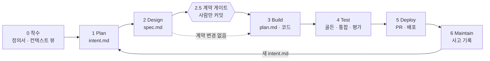

# 2장. 프로세스

HOLD의 프로세스는 여덟 단계입니다. AI-Native SDLC 플레이북의 여섯 단계 앞에 **착수(Stage 0)**를, Design과 Build 사이에 **계약 게이트(Stage 2.5)**를 더했습니다. 각 단계는 커밋된 산출물로 끝나고, 그 산출물의 승인이 다음 단계를 엽니다(H4).

## 단계별 정의

| 단계 | 목적 | 커밋하는 산출물 | 필수 뷰 | 승인자 | 다음 단계를 여는 것 |
| --- | --- | --- | --- | --- | --- |
| 0 착수 | 누구를 위한 시스템인지 정한다 | `stakeholders.md`, `module-map.md`, `views/context.md` | 시스템 컨텍스트 (C4 L1) | 프로젝트 소유자 | 정의서 커밋, `check_views.py` 통과 |
| 1 Plan | 무엇을 왜 원하는지 기록한다 | `changes/<id>/intent.md` | 업무 흐름 before/after (흐름이 바뀔 때) | 제품 소유자 | intent 병합 |
| 2 Design | 요구와 설계를 한 세션으로 압축한다 | `spec.md` (아키텍처 영향, 이해관계자 영향, 계약 질문 목록), 필요 시 ADR, 필요 시 `contract_draft.py` | 시퀀스 (실패 경로 포함), Standard 이상은 컴포넌트 | 제품 소유자 + 관련 이해관계자 | spec 승인, 계약 질문 전부 답변 |
| 2.5 계약 게이트 | 경계를 넘는 데이터를 사람이 확정한다 | `app/contracts/` 변경, 계약 테스트, 사실 뷰 재생성 | 계약 클래스 뷰 (생성) | 사람만 커밋 가능 (보호 경로) | 계약 커밋. 계약 변경이 없으면 건너뜀 |
| 3 Build | 계획을 세우고 모듈별로 구현한다 | `plan.md` (모듈별 범위·완료 조건), 코드, 단위 테스트 | (Standard 이상) 모듈 의존 그래프 | 엔지니어 (위험 변경은 리드) | plan 승인 후 구현, 검사 통과 |
| 4 Test | 기준대로 동작함을 증명한다 | 골든·통합 테스트, 평가 결과 | 시퀀스 흐름 ↔ 통합 테스트 이름 | 기준은 사람 소유 (보호) | 모든 층 통과 |
| 5 Deploy | 검토하고 배포한다 | PR (리뷰 결과, 배포 영향 이해관계자) | 배포 뷰 (배포 단위가 바뀔 때) | 코드 소유자, 릴리스 승인자 | 병합, 배포 게이트 통과 |
| 6 Maintain | 운영 신호를 다음 변경으로 되돌린다 | `docs/issues/` 사고 기록 (영향 이해관계자 ID, cid), 새 `intent.md` | 사고 재구성 시퀀스 | 서비스 소유자 (분류) | 새 intent → Stage 1 |

## 단계별 진행 방법

### Stage 0 착수

1. `hold_init.py`로 키트를 설치합니다.
2. `docs/architecture/stakeholders.md`에 사람과 연관 시스템을 적습니다. 연관 시스템 행에는 계약·실패 영향·관측 이벤트 칸을 비워 두지 않습니다(3장).
3. `docs/architecture/views/context.md`에 컨텍스트 뷰를 그립니다. 정의서의 행 하나가 그림의 상자 하나입니다.
4. `docs/architecture/module-map.md`에 모듈 후보를 적고, 네 질문(4장 A1)으로 사람이 확정합니다.
5. `python scripts/check_views.py`가 통과하면 커밋합니다.

### Stage 1 Plan

1. 발안자가 자기 말로 문제를 설명합니다. `hold-intent` 스킬이 인터뷰를 진행합니다.
2. 에이전트가 `changes/<YYYYMMDD-이름>/intent.md`를 씁니다. `## 이해관계자`에는 정의서 ID만 씁니다.
3. 발안자가 잘못 이해된 부분을 고치고, 제품 소유자가 승인하면 병합합니다.

### Stage 2 Design

1. `hold-architecture`와 `hold-views` 스킬을 실은 세션에서 intent.md를 읽고 spec.md를 씁니다.
2. spec.md의 필수 절: `## 아키텍처 영향`, `## 이해관계자 영향`(정의서 ID), `## 계약 질문 목록`, `## 뷰`(sequenceDiagram, 실패 경로 포함).
3. 에이전트는 계약 질문에 **답하지 않고** 질문으로 남깁니다. 계약 초안이 필요하면 같은 폴더의 `contract_draft.py`에 씁니다.
4. 새 모듈이나 서비스 분리가 필요하면 `docs/adr/`에 ADR 초안을 씁니다.
5. 제품 소유자가 spec을 승인하고, 표시된 우려는 해당 이해관계자에게 보냅니다.

### Stage 2.5 계약 게이트

1. 사람이 계약 질문에 답합니다. 코딩이 아니라 업무 결정입니다.
2. 에이전트가 답을 반영해 `contract_draft.py`와 계약 테스트 초안을 고칩니다.
3. 사람이 초안을 `app/contracts/`로 옮기고, 계약 테스트를 `tests/contracts/`에 두고, `python scripts/gen_views.py`로 계약 클래스 뷰를 다시 만든 뒤 함께 커밋합니다. 보호 경로라 이 커밋은 사람만 할 수 있습니다.
4. 이 커밋에서 pyright·pytest가 깨지는 지점이 plan.md의 "고칠 곳" 목록이 됩니다.

### Stage 3 Build

1. 엔지니어가 plan mode로 세션을 시작하고 spec.md를 줍니다.
2. plan.md의 `## 모듈별 작업 범위`에 모듈마다 작업 범위, 수정 금지 파일, 완료 조건을 적습니다. 모듈 하나가 worktree 하나, 세션 하나입니다.
3. 승인된 plan.md를 커밋하고 구현합니다. 수정할 때마다 `post_edit.py` 훅이 경계·타입·산출물 검사를 돌립니다.
4. 구현이 계획에서 벗어나면 plan.md를 같은 커밋에서 고칩니다(R10).

### Stage 4 Test

검증 5층(4장 A7) 중 프로필이 요구하는 층을 통과해야 합니다. 채점 기준(계약·골든·평가 테스트)은 사람 소유라 에이전트가 고칠 수 없습니다. spec.md 시퀀스 뷰의 각 흐름에는 그 흐름을 고정하는 통합 테스트 이름을 적습니다.

### Stage 5 Deploy

PR 설명에 배포 영향 이해관계자와 통보 여부를 적습니다. 배포 단위가 바뀌면(4장 A5의 분리 판단) 배포 뷰와 ADR을 함께 냅니다. Lite는 사람이 직접 리뷰하고, Standard 이상은 자동 리뷰 패스를 더합니다(6장).

### Stage 6 Maintain

운영 중 문제는 `docs/issues/`에 기록합니다. 형식은 증상 → 원인 → 조치 → 재발 방지이고, 영향 받은 이해관계자 ID와 cid를 적습니다. 고치기 전에 재현 테스트를 먼저 씁니다(R11). 원인이 한 모듈 안이면 PR로, 계약이나 설계가 원인이면 새 intent.md로 Stage 1에 돌려보냅니다. 연관 시스템이 원인이면 정의서의 실패 영향 칸을 갱신하도록 사람에게 제안합니다.

## 단계 공통 규칙

- **변경 단위 폴더**: 한 변경의 intent.md, spec.md, plan.md, contract_draft.py는 `changes/<YYYYMMDD-이름>/`에 함께 둡니다. git 이력이 그대로 감사 추적이 됩니다.
- **자율의 정지선**: auto mode든 자율 루프든, 보호 경로를 바꿔야 하는 일에서 멈추고 보고하거나 intent.md를 제안합니다(H1).
- **완료의 증거**: 단계를 마쳤다는 보고에는 도구 출력을 붙입니다(H9).
- **건너뛰기 규칙**: 계약 변경이 없으면 2.5를, 흐름·배포 단위가 바뀌지 않으면 해당 뷰를 건너뜁니다. 건너뛴 자리에는 `생략: 이유`를 한 줄 남깁니다.
- **기존 도구와의 관계**: 작업 항목이 Jira 같은 도구에 이미 있다면, 산출물마다 원본을 하나 정합니다. 최소한 intent.md에 작업 항목 번호를, 작업 항목에 커밋 SHA를 서로 적습니다.
