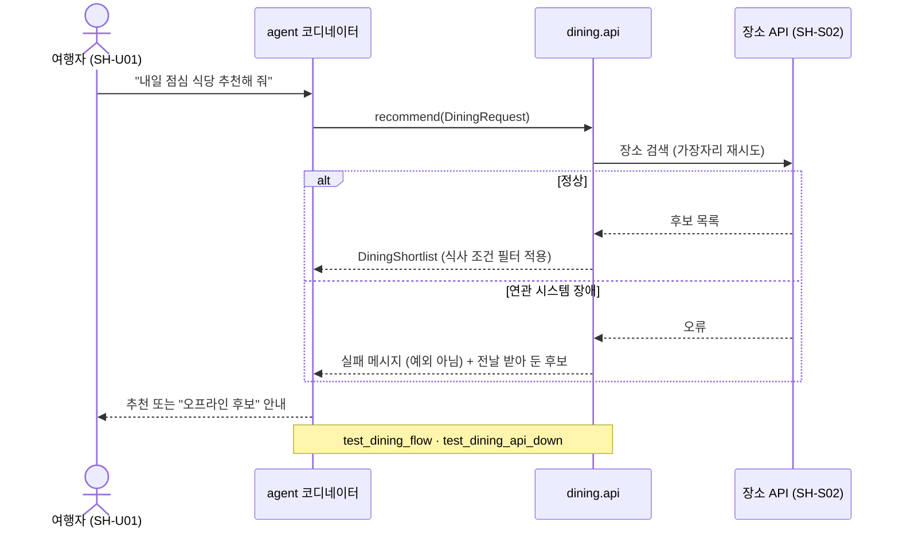

# 3장. 이해관계자와 관점

이 장은 원칙 H3(이해관계자와 관점 우선)와 H8(보이게 만든다)의 실천 방법입니다. 이해관계자 정의서 하나를 Plan보다 먼저 만들고, 모든 산출물이 정의서 ID로 이해관계자를 참조합니다. 그리고 단계마다 정해진 다이어그램이 없으면 게이트를 통과하지 못합니다.

## 3.1 이해관계자 정의

이해관계자는 시스템에 요구·제약을 주거나 시스템의 변화에 영향을 받는 **사람, 조직, 연관 시스템** 전부입니다. 연관 시스템도 사람과 같은 정의서에 올립니다.

| 분류 | ID | 예 | 시스템에 주는 것 | 받아 내는 원칙·장치 |
| --- | --- | --- | --- | --- |
| 사용자 | SH-U## | 여행자, 민원인 | 기능 요구, 수용 기준 | 평가 시나리오 (4장 A7) |
| 발주·의사결정자 | SH-D## | 발주기관, 제품 소유자 | 범위, 우선순위, 승인 | intent·spec 승인 게이트 |
| 통제·검증 주체 | SH-C## | 감리, 보안 담당, 개인정보 책임자 | 준수 요건, 제출 산출물 | 스킬(안내) + 훅(통제) |
| 운영 주체 | SH-O## | 운영자, 장애 대응 담당 | 운영·관측 요구 | 로그와 cid (4장 A6) |
| 연관 시스템 | SH-S## | 공공데이터 API, 기관 내부 시스템, LLM 제공자, DB | 인터페이스, 호출 제한, 가용성, 비용 | 계약 (A2), 가장자리 재시도 (A5) |

## 3.2 이해관계자 정의서

위치: `docs/architecture/stakeholders.md` (사람 소유, 보호 경로). 양식은 `kit/templates/stakeholders.md`입니다. 행 하나가 이해관계자 하나이고, 양방향 영향을 각각 한 칸에 적습니다.

연관 시스템 행에는 네 가지를 빠짐없이 연결합니다.

1. **계약** — 외부 명세(OpenAPI 등)에서 생성한 계약 모델 (4장 A2)
2. **가장자리 위치** — 이 시스템을 부르는 코드가 어느 모듈의 `_internal/` 또는 `platform/` 한 곳뿐인가 (A1·A5)
3. **실패 영향** — 이 시스템이 멈추면 무엇이 빠지고 무엇은 계속 되는가 (A5)
4. **관측 이벤트** — 이 시스템 호출을 남기는 로그 이벤트 이름 (A6)

에이전트는 정의서를 직접 고치지 않습니다. 정의서에 없는 대상을 발견하면 intent.md의 `## 정의서 추가 제안`에 적고, 사람이 반영합니다.

## 3.3 영향 분석: 변경마다, 양방향으로

정의서는 시스템 전체의 기준선이고, 영향 분석은 변경 하나마다 spec.md에서 합니다.

- **이해관계자 → 시스템**: 이 변경에 요구나 제약을 더하는 이해관계자는 누구인가. 예: 연계 API의 호출 제한, 감리가 요구하는 추적성.
- **시스템 → 이해관계자**: 이 변경이 누구에게 닿는가. 예: 계약 변경이 하위 연계 시스템을 깨는가, 호출량 증가가 비용을 바꾸는가.

spec.md의 `## 이해관계자 영향` 표는 ID, 방향, 내용, 통보·승인 필요 여부의 네 칸입니다. "승인 필요" 행은 spec 승인 전에 그 이해관계자에게 보냅니다.

## 3.4 단계별 이해관계자 반영

| 단계 | 추가하는 내용 | 산출물 |
| --- | --- | --- |
| 0 착수 | 정의서 초안 + 컨텍스트 뷰 | `stakeholders.md`, `views/context.md` |
| 1 Plan | `## 이해관계자`: 발안자와 영향 대상을 ID로 | intent.md |
| 2 Design | 양방향 영향 표, 승인 필요 이해관계자 지정 | spec.md |
| 2.5 계약 | 연관 시스템 계약은 그 시스템 명세에서 생성, 사람은 의미만 확인 | `app/contracts/` |
| 3 Build | 모듈 CLAUDE.md에 "맞닿는 이해관계자" | `app/modules/*/CLAUDE.md` |
| 4 Test | 사람 이해관계자의 수용 기준 → 평가 시나리오, 연관 시스템 → 가짜 어댑터 계약 테스트 | `tests/evals/`, `tests/contracts/` |
| 5 Deploy | 배포 영향 대상과 통보 여부 | PR 설명 |
| 6 Maintain | 사고 기록에 영향 받은 ID, 연관 시스템이 원인이면 정의서 갱신 제안 | `docs/issues/` |

## 3.5 필수 뷰

### 세 가지 규칙

1. **뷰는 이해관계자의 관심사에 답한다.** 모든 다이어그램 바로 위에 `누구의 어떤 질문: <독자> — <질문>`을 적습니다.
2. **그림은 텍스트로 쓴다.** 마크다운 안의 Mermaid 블록으로 씁니다. git diff로 바뀐 곳이 보이고, 에이전트가 읽고 고칠 수 있으며, GitHub과 Obsidian이 그대로 렌더링합니다. 이미지 파일은 제출용 내보내기로만 만듭니다.
3. **의도 뷰는 사람이 승인하고, 사실 뷰는 코드에서 생성한다.** 앞으로 만들 구조는 손으로 그리고 승인합니다. 이미 있는 구조는 `gen_views.py`로 뽑아냅니다. 그래야 그림과 코드가 어긋나지 않습니다.

### 단계별 필수 뷰

UML 다이어그램 전부를 강제하면 문서 비용을 감당할 수 없으므로, 관심사에 답하는 최소 집합만 정합니다. 구조는 C4 모델의 단계로, 행위는 UML 시퀀스·상태·활동으로 그립니다.

| 단계 | 뷰 | 표기 | 주 독자 | 종류 | Lite | Standard 이상 |
| --- | --- | --- | --- | --- | --- | --- |
| 0 착수 | 시스템 컨텍스트 | C4 L1 (`flowchart`) | 모든 이해관계자 | 의도 | **필수** | 필수 |
| 1 Plan | 업무 흐름 before/after | UML 활동 (`flowchart`) | 발안자, 제품 소유자 | 의도 | 흐름이 바뀔 때 | 흐름이 바뀔 때 |
| 2 Design | 핵심 상호작용 (실패 경로 포함) | UML 시퀀스 | 엔지니어, 연관 시스템 담당 | 의도 | **필수** | 필수 |
| 2 Design | 컴포넌트 변경분 | C4 L2·L3 | 엔지니어, 감리 | 의도 | 선택 | **필수** (변화 없으면 생략 사유) |
| 2 Design | 상태 전이 | UML 상태 | 엔지니어 | 의도 | 상태가 있을 때 | 상태가 있을 때 |
| 2.5 계약 | 계약 모델 관계 | UML 클래스 | 계약 승인자 | 사실 (Pydantic에서 생성) | **필수** | 필수 |
| 2.5 계약 | 데이터 소유 구조 | ER | 데이터 소유자, 감리 | 사실 (스키마에서 생성) | — | v0.2 예정 |
| 3 Build | 모듈 의존, 서비스 에이전트 그래프 | `flowchart` | 엔지니어, 리뷰어 | 사실 (import·LangGraph에서 생성) | — | v0.2 예정 |
| 4 Test | 시퀀스 흐름 ↔ 통합 테스트 이름 | 시퀀스 `Note` | 리뷰어 | 연결 | 권장 | 필수 |
| 5 Deploy | 배포 뷰 | UML 배포 또는 C4 배포 | 운영자, 감리 | 의도 | 배포 단위가 바뀔 때 | 배포 단위가 바뀔 때 |
| 6 Maintain | 사고 재구성 | UML 시퀀스 (cid 로그 기준) | 운영자 | 사실 | 사고마다 | 사고마다 |

v0.1 키트가 기계로 검사하는 것은 굵게 표시한 항목 중 컨텍스트 뷰, spec의 시퀀스 뷰, Standard 이상의 컴포넌트 뷰, 계약 클래스 뷰의 최신성입니다. 나머지는 스킬(`hold-views`)의 안내에 머뭅니다.

### 시퀀스 뷰 예시 (가상 여행 가이드)

이 그림에서 가장 중요한 것은 `alt` 아래의 실패 분기입니다. "여행 중 연결이 끊기거나 API가 응답하지 않으면 사용자는 무엇을 보나"를 그림을 그리는 순간 결정해야 합니다.
