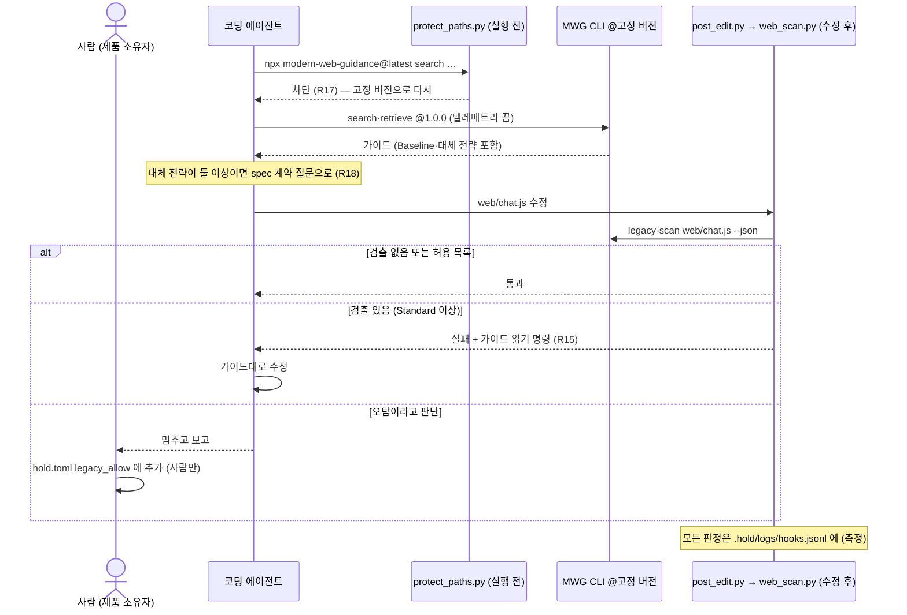

# 9장. 웹 프런트엔드 확장 — Modern Web Guidance 통합

> 확장 **web-0.1** · 코어 v0.1과 함께 씀 · 기본 꺼짐 · 근거 등급: **가설** (실증 0회)

이 장은 웹 UI가 있는 프로젝트에서 Chrome 팀의 **Modern Web Guidance**(이하 MWG)를 HOLD 안으로 들이는 방법입니다. 확장은 원칙 H1~H10과 코어 규칙 R01~R13을 바꾸지 않습니다. `hold.toml`의 `[web].enabled`를 켜지 않으면 키트는 코어와 똑같이 동작합니다. 확장을 두는 규칙은 [8장 확장](08-revision.md#확장)에, 이 확장을 이렇게 만든 이유는 [방법론 ADR 0002](../method-adr/0002-web-extension-mwg.md)에 있습니다.

한 줄로 줄이면 이렇습니다.

> 무엇이 최신 웹 방식인지는 MWG가 알려 주고, 어느 브라우저를 지원할지와 어느 판의 가이드를 따를지는 사람이 정하며, 그 선은 HOLD 키트가 지킨다.

## 9.1 왜 필요한가

### 에이전트는 오래된 방식으로 프런트엔드를 짠다

코딩 에이전트의 학습 데이터에는 오래된 웹 코드가 압도적으로 많습니다. 그래서 에이전트는 브라우저가 이미 기본으로 제공하는 기능이 있어도, 몇 년 전 방식으로 문제를 풉니다.

- 모달을 `<div>`와 JavaScript로 만들고, `body { overflow: hidden }`으로 스크롤을 막는다 (`<dialog>`, Popover API가 있는데도)
- 툴팁 위치를 JavaScript로 계산한다 (CSS Anchor Positioning이 있는데도)
- 채팅 입력창에서 Enter를 누르면 바로 전송한다. 한글처럼 IME로 조합하는 언어에서는 조합 중인 글자가 덜 끝난 채 전송된다
- CDN 스크립트를 무결성 검증(SRI) 없이 불러온다

이런 코드는 **동작은 하므로 테스트를 통과합니다.** 그래서 더 위험합니다. 0장의 세 부채로 보면 이렇습니다.

| 부채 | 오래된 프런트엔드 코드가 남기는 것 |
| --- | --- |
| 기술부채 | 플랫폼보다 뒤처진 코드, 필요 없는 라이브러리와 폴리필, 접근성·성능 결함 |
| 의도부채 | 이 폴리필이 왜 있는지, 어느 브라우저를 지원하려고 넣었는지 아무도 모름. 지원 브라우저를 누가 정했는지도 모름 |
| 인지부채 | 브라우저 호환성은 사람도 다 기억하지 못함. 에이전트가 고른 대체 코드가 맞는지 판단할 근거가 없음 |

### HOLD v0.1 키트에는 프런트엔드 통제가 없다

v0.1 키트의 통제 장치(pyright, import-linter, Pydantic 계약, 계약·골든 테스트)는 모두 Python 백엔드를 위한 것입니다. 프로젝트에 웹 UI를 붙이는 순간 프런트엔드 코드는 **안내도 통제도 없는 영역**이 됩니다. H7("안내는 스킬, 통제는 기계")로 보면 그 영역에는 안내층과 통제층이 모두 비어 있습니다.

### 직접 만들지 않고 외부 가이드를 들이는 이유

1. **웹 플랫폼은 빠르게 바뀝니다.** 브라우저별 지원 현황을 1인이 계속 따라가며 가이드를 고칠 수 없습니다.
2. **MWG는 브라우저를 만드는 쪽이 씁니다.** 가이드마다 브라우저 호환성 데이터(Baseline)와 대체 코드 권고가 붙어 있고, 에이전트를 대상으로 한 평가 체계가 있습니다.
3. **HOLD의 강점은 내용이 아니라 소유와 통제입니다.** 그래서 HOLD가 할 일은 가이드를 새로 쓰는 것이 아닙니다. 외부 가이드를 사람이 소유한 선 안으로 들이는 연결층(바인딩)을 만드는 것입니다.

## 9.2 Modern Web Guidance 개요

아래 내용은 2026-11-12에 패키지 1.0.0을 직접 받아 확인했습니다.

| 항목 | 내용 |
| --- | --- |
| 무엇 | 코딩 에이전트에 웹 플랫폼 전문 지식, 권장 방식, 브라우저 호환성 데이터를 넣어 주는 에이전트 skill과 CLI |
| 만든 곳 | Google Chrome 팀이 만들고 Chrome·Microsoft Edge·Mozilla Firefox·MDN 팀이 함께 관리. Google I/O 2026에서 발표 |
| 판 | 1.0.0 (2026-11-10). 첫 공개판 0.0.55(2026-04-30) 이후 121번 배포 |
| 내용 | 가이드 208개. 분류: html, css, js, forms, accessibility, performance, security, privacy, pwa, built-in-ai, webmcp, visual-design 등 |
| 구성 | `SKILL.md`(에이전트 지시) + CLI `modern-web-guidance`(`search`, `retrieve`, `list`, `legacy-scan`) + 가이드 마크다운 |
| 실행 요구 | Node.js 22 이상, `npx`. CLI가 패키지에 함께 들어 있음 |
| 지원 에이전트 | Claude Code, Codex, Copilot CLI, Gemini CLI, Antigravity, goose 등. Claude Code는 공식 플러그인 마켓플레이스에도 있음 |
| 라이선스 | 코드·skill Apache-2.0, 문서 CC BY 4.0 |
| 저장소 | [GoogleChrome/modern-web-guidance](https://github.com/GoogleChrome/modern-web-guidance) (배포본), [modern-web-guidance-src](https://github.com/GoogleChrome/modern-web-guidance-src) (원본·평가) |

### 작동 방식

MWG의 `SKILL.md`는 에이전트에게 네 단계를 지시합니다.

1. **Search.** HTML·CSS·클라이언트 JS 작업을 시작할 때 2~5단어 질의로 가이드를 찾는다. 예: `"light dismiss dialog"`.
2. **Retrieve.** 찾은 ID의 가이드 본문(마크다운)을 읽는다. 가이드에는 구현 방식, 접근성, 브라우저 지원 현황, 대체 전략이 들어 있다.
3. **Verify.** 구현이 가이드의 권장 방식과 대체 전략을 따르는지 교차 확인한다.
4. **Disclose.** 응답 끝에 `### Modern Web Guidance` 절을 붙여, 어떤 가이드가 구현에 영향을 줬는지 밝힌다.

기존 코드를 현대화하는 별도 흐름으로 `legacy-scan`이 있습니다. 정해진 규칙으로 레거시 패턴을 찾는 정적 검사입니다.

### Baseline

Baseline은 웹 기능의 브라우저 지원 수준을 나타내는 공통 기준입니다(web.dev). MWG의 대체 코드 판단은 이 기준을 따릅니다.

| 수준 | 뜻 | MWG의 기본 판단 |
| --- | --- | --- |
| Widely available | 주요 브라우저 모두에서 30개월 이상 지원 | 대체 코드 없이 사용 (기본값) |
| Newly available | 주요 브라우저 모두에서 지원한 지 30개월 미만 | 가이드의 대체 권고를 따름 |
| Limited availability | 일부 브라우저만 지원 | 가이드의 대체 권고를 반드시 따름 |
| `Baseline YYYY` 타겟 | 그 해까지 Baseline이 된 기능 | 프로젝트가 정하면 그 해 이하의 기능은 대체 코드 없이 사용 |

### 제작사가 공개한 평가 (외부 근거)

MWG 저장소는 가이드 없이 짠 코드와 가이드를 쓰고 짠 코드를 같은 과제로 채점한 결과를 공개합니다. 2026-11-08 결과는 이렇습니다.

| 에이전트 + 모델 | 과제 / 채점 항목 | 가이드 없음 → 가이드 있음 |
| --- | --- | --- |
| Claude Code (Opus 5.5) | 215 / 1,801 | 57% → 88% (+31%p) |
| Codex CLI (gpt-6.1-sol) | 215 / 1,795 | 54% → 82% (+28%p) |
| Antigravity CLI (gemini-4-argon) | 214 / 1,673 | 58% → 94% (+36%p) |

해석할 때 주의할 점이 있습니다. **제작사가 만든 과제를 제작사가 만든 채점 기준으로 잰 값**이고, 재는 것은 "Chrome 팀이 권장하는 방식을 얼마나 따랐나"입니다. 앱 전체의 품질이나 개발 속도를 잰 값이 아닙니다. HOLD는 이 수치를 외부 근거로만 표시하고, 확장의 근거 등급은 실증으로만 올립니다(8장).

### 직접 확인한 특성 (1.0.0, 2026-11-12)

- **가이드는 호출할 때마다 최신판을 받습니다.** 원본 `SKILL.md`는 모든 명령을 `npx -y modern-web-guidance@latest …`로 지시합니다. 사용자가 아무것도 하지 않아도 가이드 내용이 바뀝니다. 10월에는 대략 주 1회, 11월 6~9일에는 12시간 간격으로 배포됐습니다.
- **업데이트를 독촉합니다.** CLI는 에이전트가 넘긴 skill 버전을 자기 버전과 비교합니다. 5일 넘게 뒤처지면 경고하고, 60일 이상 뒤처지면 에이전트에게 사용자를 설득해 업데이트하게 하라는 메시지("Be a great agent and insist that the user upgrade the skill")를 보냅니다.
- **지원 정책을 에이전트가 문서에 넣도록 유도합니다.** 원본 `SKILL.md`의 "Reactive Policy Discovery"는 특정 상황에서 브라우저 지원 정책을 `CLAUDE.md`나 `AGENTS.md`에 적자고 제안하라고 지시합니다.
- **`legacy-scan`은 통제 장치가 아닙니다.** 규칙 35개(가이드 33개, 전체의 약 20%)만 검사합니다. 검출이 있어도 종료 코드가 항상 0입니다. 레거시 패턴 7개를 넣은 시험 페이지에서는 2개를 검출했습니다(IME를 고려하지 않은 Enter 처리, CDN 스크립트의 SRI 누락). 파일 하나만 검사할 수도 있고, 검출마다 오탐을 가르는 기준(`keepWhen`/`dropWhen`)이 붙어 있습니다.
- **텔레메트리가 있습니다.** 설치 수, 호출한 에이전트 이름, 가이드 ID, 에이전트가 만든 검색어를 Google로 보냅니다(사용자 원문 프롬프트는 보내지 않음). `DISABLE_TELEMETRY=1`로 끕니다.
- **검색이 빠릅니다.** 한 번에 약 2초 걸립니다.

## 9.3 그대로 들이면 생기는 충돌

MWG를 플러그인으로 그냥 설치하면 아래 지점에서 HOLD의 원칙과 부딪힙니다. 확장 web-0.1의 장치는 모두 이 표에서 나왔습니다.

| # | MWG의 기본 동작 | 부딪히는 원칙 | 무엇이 문제인가 | 확장의 해법 |
| --- | --- | --- | --- | --- |
| 1 | 지원 정책을 `CLAUDE.md`·`AGENTS.md`에 적자고 제안 | H1 | 루트 `CLAUDE.md`는 보호 경로가 아니다. "어느 사용자의 브라우저를 지원하나"라는 업무 결정이 사람의 확정 없이 바뀔 수 있다 | 정책의 원본은 `hold.toml [web]`(보호). 고정 skill에 그 정책을 옮겨 적고, 제안 지시를 덮어쓴다 (R14) |
| 2 | 대체 전략이 여럿이면 에이전트가 고름 | H5 | 기능을 빼느냐, 단순 대체냐, 폴리필이냐는 업무 결정이다 | spec의 계약 질문으로 남긴다 (R18) |
| 3 | 매 호출 `@latest` | H10, 8장 동결 | 실증 중 외부 가이드가 바뀌면 측정 결과가 어느 판의 것인지 말할 수 없다 | 버전 고정. 올리는 것은 사람의 변경 (R17) |
| 4 | 60일 지나면 사용자를 설득하라고 지시 | H1 | 도구가 에이전트를 통해 사람의 결정을 압박한다 | skill과 CLI를 같은 패키지에서 고정해 경고 자체를 없애고, 나와도 보고만 하게 한다 (R17) |
| 5 | 응답 끝의 `### Modern Web Guidance` 절 | H9 | 에이전트의 말이지 증거가 아니다. 기억으로 지어낸 ID가 섞일 수 있다 | spec에 ID를 적고 고정 목록과 대조. 실제 `retrieve` 실행은 훅 로그로 남김 (R16) |
| 6 | `legacy-scan` 종료 코드 항상 0, 오탐 판단은 사람 | H7 | 그대로는 통제 장치가 아니다. 반대로 실패로 만들면 에이전트가 검출을 없애려고 코드를 비튼다 | 래퍼가 판정하고, 받아들인 검출은 사람이 허용 목록(보호)에 적는다 (R15) |
| 7 | 텔레메트리 기본 켜짐 | H3 (통제·검증 주체) | 공공 과제에서 검색어가 외부로 나간다 | 기본 끔 |
| 8 | 매 호출 네트워크 | — | 폐쇄망에서 쓸 수 없다 | 미리 받은 패키지(tarball)로 설치, npm 캐시로 실행 |

## 9.4 원칙별 통합 방식

| 원칙 | 확장에서의 적용 |
| --- | --- |
| H1 사람의 역할 | 지원 기준, 대체 동작 정책, MWG 버전, 허용 목록은 모두 `hold.toml`에 있고 사람만 고칩니다. 고정 skill(`.claude/`)과 가이드 목록(`docs/hold/web/`)도 보호 경로입니다 |
| H2 모든 산출물에 주인 | 가이드 내용의 주인은 MWG(외부), 어느 판을 쓸지의 주인은 사람입니다. 고정 skill은 스크립트가 만들고 사람이 커밋합니다 |
| H3 이해관계자와 관점 | 이해관계자 정의서의 사람 행에 **사용 환경**(기기·브라우저·망) 칸을 둡니다. 지원 기준은 이 칸에서 나옵니다. "Edge 최신을 쓰는 내부망 공무원"과 "구형 iPhone을 쓰는 시민"은 다른 기준을 요구합니다 |
| H4 커밋된 산출물 체인 | spec.md의 `## 참조 가이드`가 "어떤 외부 기준을 근거로 이렇게 구현했나"의 기록이 됩니다. 버전 변경은 intent로 남습니다 |
| H5 계약 우선 | 지원 기준 밖 브라우저에서의 동작은 화면이라는 경계의 계약입니다. 가이드의 대체 전략 중 하나를 고르는 일은 계약 질문입니다 |
| H7 안내는 스킬, 통제는 기계 | 안내는 고정 skill과 CLAUDE.md, 통제는 훅(레거시 검사, 버전 고정 호출)과 산출물 검사입니다. 장치가 없는 규칙(R18)은 "안내만"으로 표시합니다 |
| H8 보이게 만든다 | v0.1 확장은 새 필수 뷰를 더하지 않습니다. 지원 브라우저 매트릭스 뷰는 v0.2 후보입니다 |
| H9 에이전트가 읽는 증거 | 완료의 증거는 레거시 검사 출력, 산출물 검사 출력, 훅 로그의 `retrieve` 기록입니다. 응답 끝의 공개 절은 증거가 아닙니다 |
| H10 닫힌 루프 | MWG 버전을 올리는 일은 프로젝트의 변경(intent)입니다. 확장 자체는 실증 회고에서 유지·수정·삭제를 판정합니다 |

## 9.5 단계별 통합

| 단계 | 더하는 것 | 누가 | 검사 |
| --- | --- | --- | --- |
| 0 착수 | 정의서 사람 행의 **사용 환경** 칸 → `hold.toml [web]`의 `baseline`·`fallback_policy` → `hold_web_sync.py`로 고정 설치 | 사람 | `check_views.py`: 사용 환경 칸, 가이드 목록 존재. `hold_web_sync.py --check`: 버전 일치 |
| 1 Plan | 변경이 화면을 바꾸면 intent.md의 `## 이해관계자`에 그 화면을 쓰는 사람 ID를 적는다 | 발안자 | 코어와 같음 |
| 2 Design | 에이전트가 고정 skill로 `search`·`retrieve` → spec.md `## 참조 가이드`에 ID와 적용점. 대체 전략이 여럿이면 `## 계약 질문 목록`에 `(웹)` 질문 | 에이전트 초안, 제품 소유자 승인 | `check_views.py`: 참조 가이드 절, ID가 고정 목록에 있는지 (R16) |
| 2.5 계약 게이트 | `(웹)` 계약 질문에 사람이 답한다. 답이 프로젝트 전체 정책이면 `fallback_policy`로 올리고 `hold_web_sync.py`를 다시 실행한다 | 사람 | — |
| 3 Build | 프런트엔드 파일을 고칠 때마다 훅이 고정 버전 `legacy-scan`을 돌린다. Lite는 기록만, Standard 이상은 에이전트에게 되돌린다. 비고정 MWG 호출은 실행 전에 막힌다 | 에이전트 | `post_edit.py` → `web_scan.py` (R15), `protect_paths.py` (R17) |
| 4 Test | 지원 기준 밖 브라우저의 동작을 계약 질문의 답대로 고정하는 테스트(골든·평가, 보호)를 둔다 | 기준은 사람 소유 | 코어와 같음 |
| 5 Deploy | PR 설명에 참조 가이드, 레거시 검출과 허용 목록 변경을 적는다 | 엔지니어 | pre-commit: `hold-web-pinned`, `hold-web-legacy-scan` |
| 6 Maintain | 특정 브라우저에서 사고가 나면 사고 기록에 브라우저·버전을 적고, 원인이 지원 기준이면 정의서의 사용 환경 갱신과 새 intent를 제안한다 | 서비스 소유자 | 코어와 같음 |

### Build 단계의 흐름

누구의 어떤 질문: 엔지니어·리뷰어 — 에이전트가 프런트엔드 코드를 고칠 때 어떤 장치가 언제 끼어드나?



## 9.6 설정: `hold.toml`의 `[web]`

| 키 | 기본값 | 뜻 |
| --- | --- | --- |
| `enabled` | `false` | 확장을 켠다. 끄면 모든 웹 검사가 통과하고 키트는 코어와 같게 동작한다 |
| `ext_version` | `"0.1"` | 확장 판. 측정 시트에 함께 적는다 |
| `mwg_version` | `"1.0.0"` | MWG 고정 버전 (R17) |
| `baseline` | `"widely"` | 지원 기준 (R14). `widely`, `newly`, 또는 연도(`"2024"`) |
| `fallback_policy` | `""` | 지원 기준 밖 브라우저의 대체 동작 정책. 사람이 한두 문장으로 쓴다. 예: "외부 폴리필 금지, 20줄 이하의 자체 대체 코드만" |
| `telemetry` | `false` | `false`면 MWG 호출에 `DISABLE_TELEMETRY=1`을 붙인다 |
| `legacy_scan` | `"auto"` | `off`, `log`, `block`, `auto`(Lite는 log, Standard 이상은 block) |
| `legacy_allow` | `[]` | 받아들인 검출. `"가이드ID"` 또는 `"가이드ID:경로 패턴"` |
| `frontend_suffixes` | `.html` `.css` `.js` `.ts` `.tsx` `.vue` 등 | 검사할 파일 |
| `skip_dirs` | `node_modules`, `dist`, `build` 등 | 검사하지 않을 폴더 (외부 코드, 빌드 결과) |

### 지원 기준을 정하는 법

지원 기준은 기술 선택이 아니라 **누구를 지원하느냐**의 결정입니다. 정의서의 사용 환경 칸에서 시작합니다.

1. 사람 행마다 사용 환경을 적습니다. 예: "기관 내부망, 관리형 Edge 최신", "시민, 모바일 Safari·삼성 인터넷 포함, 구형 기기 있음".
2. 가장 오래된 환경을 기준으로 정합니다. 관리형 브라우저만 쓰는 내부 업무 시스템이라면 연도 타겟(`"2024"` 등)을 검토할 수 있습니다. 불특정 시민이 쓰는 서비스라면 `widely`가 안전합니다.
3. 확신이 없으면 기본값 `widely`로 두고, 사고 기록(Stage 6)이 근거를 줄 때 바꿉니다.

## 9.7 키트 구성과 설치

| 위치 | 원본 | 역할 | 소유 |
| --- | --- | --- | --- |
| `hold.toml`의 `[web]` | `templates/hold.toml` | 확장 설정, 정책의 원본 | 사람 (보호) |
| `scripts/hold_web_sync.py` | `scripts/` | 고정 버전 설치·검사 (`--check`) | 사람이 실행 |
| `scripts/web_scan.py` | `scripts/` | `legacy-scan` 래퍼: 고정 버전 실행, 판정, 허용 목록 | 키트 |
| `.claude/skills/modern-web-guidance/SKILL.md` | MWG 패키지에서 생성 | 고정 버전 skill + "HOLD 프로젝트 규칙" 절 | 사람 (보호) |
| `.claude/skills/modern-web-guidance/LICENSE` | MWG 패키지 | Apache-2.0 사본 | 사람 (보호) |
| `docs/hold/web/guides.json` | MWG 패키지에서 생성 | 고정 버전의 가이드 ID 목록 (R16 대조용) | 사람 (보호) |
| `post_edit.py` (확장 부분) | `hooks/` | 프런트엔드 수정 후 레거시 검사, MWG `search`·`retrieve` 실행 기록 | 키트 |
| `protect_paths.py` (확장 부분) | `hooks/` | 비고정 MWG 호출과 설정 변경 명령 차단 | 키트 |
| `check_views.py` (확장 부분) | `scripts/` | 사용 환경 칸, 가이드 목록, 참조 가이드 검사 | 키트 |

확장이 꺼져 있어도 스크립트는 설치되지만, 아무 일도 하지 않습니다. 정의서 양식의 "사용 환경" 칸과 spec 양식의 `## 참조 가이드` 절도 함께 들어갑니다. 웹 UI가 없으면 "해당 없음", "생략: 이유"로 둡니다.

### 설치 절차

```bash
# 1. 키트 설치 (새 프로젝트). 기존 프로젝트는 hold.toml 의 [web].enabled 를 true 로 바꾼다
python kit/scripts/hold_init.py --target ../my-app --profile lite --web

# 2. (사람) 정의서의 사용 환경 칸을 채우고 hold.toml [web] 의 baseline·fallback_policy 를 정한다

# 3. (사람) 고정 버전 설치 — Node.js 22 이상, npm 필요
cd ../my-app
python scripts/hold_web_sync.py
python scripts/hold_web_sync.py --check
python scripts/check_views.py

# 4. (사람) 생성된 파일을 검토하고 커밋한 뒤 Claude Code 를 다시 시작한다
```

`hold_web_sync.py`가 MWG 원본 `SKILL.md`에서 바꾸는 것은 네 가지입니다.

1. `modern-web-guidance@latest`를 `@<mwg_version>`으로 고정합니다. 원본에서 이 문자열을 찾지 못하면 **멈춥니다.** 원본 형식이 바뀌었다는 뜻이므로, 조용히 잘못된 skill을 만들지 않습니다.
2. 텔레메트리를 끄면 MWG 명령 앞에 `DISABLE_TELEMETRY=1`을 붙입니다. 이 환경 변수를 `.claude/settings.json`의 `env`에 전역으로 두지 않는 이유가 있습니다. Claude Code 자체도 같은 이름의 변수를 읽어 Statsig 텔레메트리와 일부 기능을 끄기 때문입니다. 끄고 싶은 범위가 MWG뿐이라면 명령에만 붙이는 것이 정확합니다. 둘 다 끄려는 Regulated 프로젝트라면 관리 설정에서 함께 끕니다.
3. 머리에 생성 표시를 넣습니다. 원본 출처, 라이선스, 바꾼 점을 적습니다(Apache-2.0의 변경 고지).
4. 끝에 **"HOLD 프로젝트 규칙"** 절을 붙입니다. 지원 기준과 대체 정책을 옮겨 적고, R14~R18을 에이전트용으로 다시 씁니다. 이 절이 원본 내용보다 우선한다고 명시합니다.

skill과 CLI를 **같은 패키지에서** 고정하기 때문에, 둘의 버전이 어긋나서 생기는 업데이트 독촉이 나오지 않습니다. 버전을 일부러 어긋나게 해서 독촉 메시지가 나오는 것도 확인했습니다(ADR 0002).

### MWG 플러그인과의 관계

Claude Code 플러그인(`modern-web-guidance@claude-plugins-official` 또는 `@googlechrome`)은 원본 `SKILL.md`를 그대로 씁니다. 그래서 `@latest`로 동작하고 HOLD 규칙 절도 없습니다. 웹 확장을 켠 프로젝트에서는 **플러그인을 끄고 프로젝트 skill만** 씁니다. 둘이 함께 있으면 에이전트가 어느 지시를 따를지 보장할 수 없습니다. 플러그인이 켜져 있어도 비고정 호출은 `protect_paths.py`가 막지만, 막힌 뒤 다시 시도하는 비용이 듭니다.

### 폐쇄망

인터넷이 되는 곳에서 `npm pack modern-web-guidance@<버전>`으로 tarball을 받아 반입한 뒤 다음을 실행합니다.

```bash
python scripts/hold_web_sync.py --tarball modern-web-guidance-1.0.0.tgz
```

에이전트가 실행하는 `npx` 호출과 레거시 검사도 패키지가 필요합니다. 같은 tarball을 내부 npm 저장소에 올리거나, `npm cache add <tarball>`로 캐시에 넣어 둡니다. 패키지를 찾지 못하면 레거시 검사는 건너뛰고 훅 로그에 `skip`으로 남습니다. 측정 시트의 스킵 비율로 이 상태를 드러냅니다.

### Windows

Claude Code는 Windows에서도 Bash 도구를 Git Bash로 실행하므로 `DISABLE_TELEMETRY=1 npx …` 형식이 그대로 동작합니다. 키트의 훅과 스크립트는 `npx.cmd`를 찾아 실행합니다.

## 9.8 통제 대응표 (확장 규칙 R14~R18)

코어 대응표(5.5)의 R01~R13에 이어 번호를 붙입니다. 확장 규칙 5개 중 **2개는 강제, 2개는 부분 강제, 1개는 안내만**입니다.

| R | 규칙 | 원칙 | 안내 | 통제 장치 | 시점 | web-0.1 |
| --- | --- | --- | --- | --- | --- | --- |
| R14 | 지원 기준과 대체 정책은 사람이 정하고, `hold.toml`에만 둔다 | H1·H3 | 고정 skill의 HOLD 절, CLAUDE.md | `hold.toml`·`.claude/` 보호 (`protect_paths.py`), 정의서 사용 환경 칸 검사 (`check_views.py`) | 수정 시도, 수정 직후 | 부분 (원본은 보호되지만, 에이전트가 CLAUDE.md에 정책 문구를 쓰는 것 자체는 막지 못함) |
| R15 | 프런트엔드 코드는 고정 버전의 레거시 규칙을 통과하거나, 사람이 허용 목록에 올린다 | H7 | MWG skill | `post_edit.py` → `web_scan.py`, pre-commit `hold-web-legacy-scan` | 수정 직후, 커밋 | 부분 (규칙 35개, 가이드의 약 20%. Lite는 기록만) |
| R16 | spec은 참조한 가이드를 고정 목록의 ID로 적는다 | H4·H9 | 고정 skill의 HOLD 절 | `check_views.py` (훅, pre-commit). 실제 `retrieve`는 훅 로그로 관찰 | 수정 직후, 커밋 | 강제 (형식과 ID 존재. 실제로 읽었는지는 측정으로 봄) |
| R17 | 가이드 버전은 사람이 고정하고 올린다. 에이전트는 고정 버전으로만 부른다 | H1·H10 | 고정 skill의 HOLD 절 | `protect_paths.py` (비고정 호출, `install`·`update`·`set-allow-*` 차단), 보호 경로, `hold_web_sync.py --check` (pre-commit), sync 스크립트의 에이전트 셸 거부 | 실행 시도, 커밋 | 강제 (Bash는 휴리스틱) |
| R18 | 가이드가 대체 전략을 둘 이상 제시하면 에이전트가 고르지 않고 계약 질문으로 남긴다 | H5 | 고정 skill의 HOLD 절, spec 양식의 `(웹)` 질문, CLAUDE.md | — | — | 안내만 |

R18은 장치가 없는 규칙이라 실증에서 가장 먼저 깨질 후보입니다. 마찰 기록에서 특히 지켜봅니다. 예: 에이전트가 계약 질문 없이 폴리필을 넣었는가.

### 키트의 검증

확장 장치는 `tests/test_web.py`의 41개 테스트로 검증합니다. 코어 테스트 37개는 확장 추가 후에도 그대로 통과합니다. 네트워크 없이 돌도록 가짜 `npx`와 가짜 MWG 패키지를 씁니다.

- 고정 설치: `@latest` 제거, 텔레메트리 끔, HOLD 절, 지원 기준 반영 / 버전 불일치·플러그인 원본 복사 → `--check` 실패 / 원본 형식 변경·패키지 버전 불일치 → 설치 중단 / 에이전트 셸에서 실행 → 거부
- 레거시 검사: Standard → 차단, Lite → 기록만 / 허용 목록 (경로가 맞을 때만) / `node_modules`·Python 파일 → 검사 안 함 / `npx` 없음 → 건너뛰고 기록 / 확장 꺼짐 → 검사 안 함
- 호출 차단: `@latest`, 버전 생략, 다른 버전, `set-allow-*`, `update` → 차단 / 고정 버전 호출, 단순 언급(`grep`) → 허용
- 산출물: 참조 가이드 절 누락, 목록에 없는 ID, 사용 환경 칸 누락, 가이드 목록 누락 → 실패 / ID 또는 `생략: 이유` → 통과

실제 MWG 1.0.0과의 통합은 ADR 0002의 "통합 확인"에 기록했습니다.

## 9.9 프로필별 요구 수준

| 항목 | Lite | Standard | Regulated |
| --- | --- | --- | --- |
| 고정 skill·가이드 목록 | 필수 | 필수 | 필수 |
| 정의서 사용 환경 칸, 지원 기준 | 필수 | 필수 | 필수, 감리 제출본에 명시 |
| spec 참조 가이드 | 필수 | 필수 | 필수 |
| 레거시 검사 | 기록만 (`log`) | 차단 (`block`) | 차단 + 훅 로그 보존 |
| pre-commit 웹 검사 | 권장 | 필수 | 필수 |
| 텔레메트리 | 끔 | 끔 | 끔, 관리 설정으로 강제 |
| MWG 플러그인 | 프로젝트에서 끔 | 끔 | 허용 목록에서 제외 (프로젝트 skill만) |
| 하네스 평가 (6장) | — | 웹 과제 포함 권장 | 웹 과제 포함 필수 |
| 접근성 인증 | — | — | MWG 접근성 가이드는 WCAG 일반 수준이다. KWCAG(한국형 웹 콘텐츠 접근성 지침) 인증은 별도로 점검한다 |

## 9.10 측정

`hold_init.py --web`으로 설치하면 측정 시트(7장)에 아래 여섯 개 열이 더해집니다.

| 열 | 뜻 | 출처 |
| --- | --- | --- |
| `web_ext` | 확장 판 (예: `0.1`) | `hold.toml` |
| `mwg_version` | 그 변경에 쓴 MWG 고정 버전 | `hold.toml` |
| `guides_referenced` | spec.md `## 참조 가이드`의 ID 수 | spec.md |
| `guides_retrieved` | 변경 기간에 실제 `retrieve`한 ID 수 | `.hold/logs/hooks.jsonl`의 `web_guidance` |
| `legacy_findings` | 레거시 검사가 잡은 가이드 수 (허용 목록 제외) | `.hold/logs/hooks.jsonl`의 `web_scan` |
| `legacy_allowed` | 허용 목록으로 제외한 가이드 수 | 같은 로그 |

레거시 검사 기록은 `hook: "web_scan"`으로 따로 남깁니다. 에이전트에게 실제로 되돌린 실패만 코어의 `check_failures`(`post_edit` 실패)에 들어가고, Lite의 기록만 하는 검출은 들어가지 않습니다.

| 지표 | 계산 | 무엇을 보나 |
| --- | --- | --- |
| 참조 일치율 | spec의 참조 ID 중 실제 `retrieve`한 ID의 비율 | 에이전트의 말과 기록이 일치하는가 (H9) |
| 레거시 재발 | 같은 가이드가 두 번 이상 검출된 횟수 | 안내가 약한 곳. 두 번이면 CLAUDE.md "알려진 함정"에 한 줄 |
| 허용 목록 증가 | `legacy_allow` 항목 수의 변화 | 오탐이 많거나, 정책을 우회하려는 압력이 있는가 |
| 검사 스킵 비율 | `web_scan`의 `skip` / 전체 | 장치가 실제로 돌고 있는가 (오프라인, npx 없음) |

해석 규칙은 7장을 따릅니다. 특히 **레거시 검출 0은 좋은 것이 아닐 수 있습니다.** 검사 범위가 가이드의 20%뿐이기 때문입니다. 0이면 참조 일치율과 함께 봅니다.

## 9.11 알려진 한계 (web-0.1)

- **검사 범위.** 레거시 검사는 가이드의 약 20%만 다룹니다. 나머지 80%는 안내(skill)에 머뭅니다.
- **내용의 정확성.** 가이드 내용과 Baseline 데이터의 정확성은 MWG의 책임입니다. 버전을 고정하면 그 판의 오류도 함께 고정됩니다. 버전을 올리는 intent에서 MWG 변경 내역과 `guides.json`의 차이를 확인합니다.
- **원본 형식 의존.** `hold_web_sync.py`는 원본 `SKILL.md`의 명령 형식(`@latest`)에 기대어 변환합니다. 형식이 바뀌면 설치를 멈춥니다. 조용히 틀리지 않게 하려는 의도된 실패입니다.
- **R14의 빈틈.** 정책의 원본은 보호되지만, 에이전트가 CLAUDE.md에 정책 같은 문구를 쓰는 것까지는 막지 못합니다.
- **Bash 휴리스틱.** 비고정 호출 차단은 명령 문자열 검사입니다. 패키지 이름을 변수로 조립하는 등의 우회는 잡지 못합니다. `hold_web_sync.py`의 에이전트 셸 거부는 Claude Code가 설정하는 `CLAUDECODE` 환경 변수에 기댑니다.
- **텔레메트리 범위.** 끄는 범위는 고정 skill의 명령과 키트의 호출입니다. 사람이 터미널에서 MWG를 직접 실행할 때는 셸 설정(`export DISABLE_TELEMETRY=1`)이 필요합니다.
- **프레임워크.** 가이드는 바닐라 HTML/CSS/JS로 쓰여 있고, React·Vue 등에는 적응 지침만 있습니다. 레거시 검사는 소스 파일만 보고 빌드 결과는 건너뜁니다.
- **접근성 인증.** KWCAG 인증 항목은 다루지 않습니다.
- **검증 범위.** 키트 테스트는 가짜 `npx`로 장치의 동작만 확인합니다. 실제 패키지와의 통합은 1회 수동으로 확인했습니다(ADR 0002).
- **근거 등급.** 확장은 실증 0회이며, 모든 규칙의 근거 등급은 가설입니다.

## 9.12 개정

- 확장의 판 번호는 `web-0.N`입니다. 개정 규칙은 [8장 확장](08-revision.md#확장)을 따릅니다.
- **MWG 버전을 올리는 것은 방법론 개정이 아니라 프로젝트의 변경입니다.** `changes/<YYYYMMDD-mwg-x.y.z>/intent.md`에 이유를 적고, `hold.toml`의 `mwg_version`을 고친 뒤 `hold_web_sync.py`를 다시 실행합니다. `guides.json`의 차이(추가·삭제된 가이드)를 같은 커밋에 남깁니다.
- v0.2 회고에서 판정할 것: 확장을 코어로 올릴지, R14~R18 각각의 유지·수정·삭제, 지원 브라우저 매트릭스 뷰를 필수 뷰에 넣을지.
